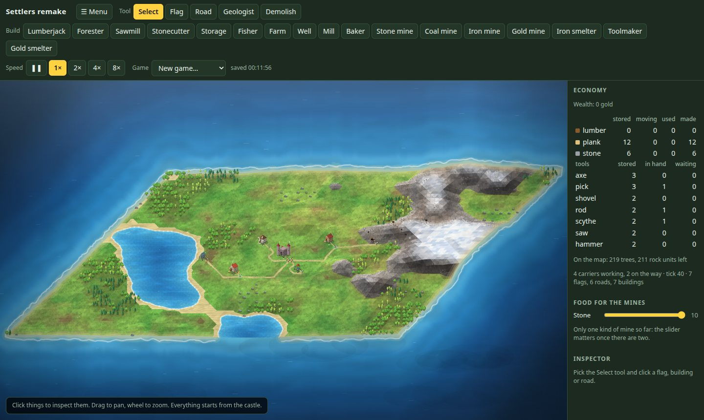
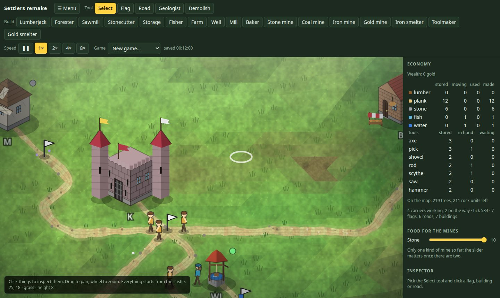
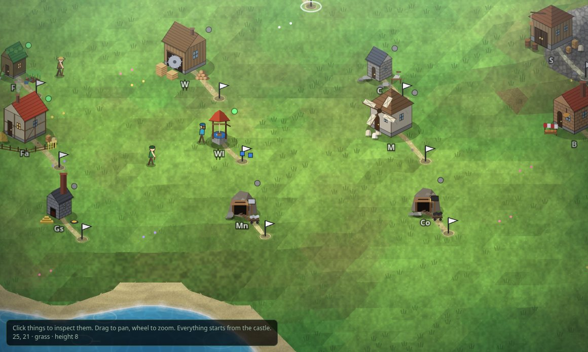
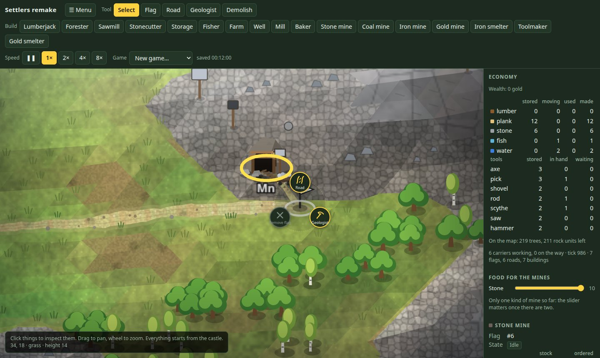

<div align="center">

# Pioneers

**A browser remake of *The Settlers* (Blue Byte, 1993), built around the part that made it special: the road-and-carrier economy.**

You never give orders to people. You lay flags and roads, place buildings, and watch a little colony organise itself: carriers hand goods along the roads, builders walk out to your sites, lumberjacks fell trees, bakers bake, geologists probe the mountains, and the whole thing hangs together or jams up depending on how well you laid it out.



</div>

> All art is drawn in code (vector shapes and generated textures). No assets from the original game are used or needed, and this project is not affiliated with Blue Byte or Ubisoft.

## Play it

You need [Node.js](https://nodejs.org) 22.12 or newer (Vitest asks for it; developed on 24) and [pnpm](https://pnpm.io).

```sh
pnpm install
pnpm dev          # open the address it prints
```

The first time, the page opens on a main screen with **New game** and **Continue game**. After that, with a saved game, it takes you straight back into it (the **Menu** button brings the main screen back). The game saves itself in your browser as you play, so closing the tab loses nothing.

Other commands:

```sh
pnpm test         # sim and client tests, including exact parity with the C++ reference
pnpm typecheck
pnpm build        # a static site in packages/client/dist
```

## How to play

You start with a castle, a few planks, some stone and a handful of tools. Everything else you build.

1. **Flags and roads.** Put a *flag*, then a *road* between two flags. Click a point on a road to put a flag there and branch off. Shorter roads carry more, so a busy road wants more flags.
2. **Buildings.** Pick a building and click a spot. Every valid spot lights up, and hovering tells you why a spot is refused. Connect its flag to the castle by road and a builder walks out; carriers bring planks and stone.
3. **Feed the economy.** Wood and stone first, then food, then mines. Watch the Economy panel: what is stored, what is moving, what is being used, what has been made.
4. **Use the flag menu.** Click a flag with the Select tool and a radial menu opens: build here (a list of the buildings that fit, with their costs), start a road, send a geologist (on or beside a mountain), or remove the flag.

Controls: `1` select, `2` flag, `3` road, `g` geologist, `x` demolish, `4`-`9` `0` `q` `w` `e` `r` `t` `y` `u` `i` `p` `o` the building sites in the order of the Build row, `space` pause, `Esc` back to Select, mouse wheel zoom, drag to pan, `f` fit the whole map, `h` back to the castle.



## What is in the game

**The economy**

- Carriers are hired on demand from storages, walk their road end to end, and hand goods on at flags. A flag holds eight items, so a jammed road backs up visibly. Busy roads call for a second carrier; spare carriers go home when it quietens.
- Goods find their own way. Each item is sent to the building that wants it most, or to a storage.
- Workers walk in from the castle. A finished building stays empty until its worker has walked over by road, carrying the tool of his trade.
- Tools: every trade needs its own (axe, pick, shovel, rod, scythe, saw, hammer, cleaver). A toolmaker makes them from iron and planks, and sliders say which kinds to make.
- Storages have limits, so a full castle sends goods on to another storage, and producers back up when nothing has room.
- Demolition follows the original: nothing is refunded, a burning building takes its stock with it, the door flag and its roads stay.

**Land and resources**

- Trees and rocks. Lumberjacks and stonecutters walk out to them; foresters plant saplings that grow back into forest.
- A farm sows fields, waits for them to ripen and cuts them.
- Food: fish from fishers, bread from farm, mill, well and baker, meat from a pig farm (wheat and water) and a butcher. Only mines eat. A food slider per kind of mine says who is fed first.
- Four kinds of ore (stone, coal, iron, gold) lie hidden under the mountains. **Send a geologist** to a flag on the rock: he walks out, probes spot after spot with his hammer and leaves signs for what he finds. Signs fade after a while.
- Mines dig their own kind of ore and run dry. Smelters turn iron ore or gold ore plus coal into metal.

**The look**

- A generated island with shores that curve smoothly, sand beaches, a sea that deepens away from the coast, drifting cloud shadows, and ground textured by what it is: meadow, forest floor, bare earth, gravel, rock, snow.
- Twenty detailed buildings that smoke, turn, glow and hammer while they work, with construction going through stages (foundation, frame, scaffolding).
- Roads worn into the land with uneven edges, wheel ruts and pebbles.
- Little people with walk cycles, tools and the hats of their trades, each marked with a letter as he walks to his new post.





## How it is built

```
packages/sim      the simulation: pure TypeScript, no DOM, deterministic, tested
packages/client   Vite + PixiJS + Preact: the game you see and play
logistics/        a C++ version of the logistics core: the oracle the sim is checked against
skeleton/         the original minimal fixed-step loop sketch
docs/             design notes and screenshots
```

- **The sim** is integers only, with no randomness and a fixed update order (flags, then buildings, then transporters), stepped at 50 Hz. The same game always plays out the same way, which is what lets a save be restored and carry on identically, and what makes it testable.
- **Parity with C++.** `logistics/` holds the logistics economy written in C++. `pnpm gen:parity` runs it over 26 scenarios and stores the numbers and a state fingerprint; the TypeScript sim must reproduce every one exactly. Everything added on top (terrain, objects, demolition, tools, mines, geologists, saving) is TypeScript-only and stays off in those scenarios.
- **The client** owns the game loop, the tools and every command; the renderer reads the sim each frame and never changes it. Panels are Preact.
- **Saving** is a versioned JSON snapshot in `localStorage` (about 10 KB), written shortly after you act, every 10 seconds while the game runs, and when the tab is hidden. A save that cannot be read is set aside, not thrown away.
- **Tests:** several hundred, covering the sim's behaviour and invariants (goods are never created or lost unexplained), save and restore at many moments, the drawing code (every building in every state, on a recording canvas), and the geometry of roads and shores. Changes are also checked by deliberately breaking the code to make sure the tests notice.

The full design notes, with every rule and number, are in [docs/DESIGN.md](docs/DESIGN.md).

## Status

Playable, and growing. The economy, the land, the mines and the look are in; there is no military, no enemies, no sound, and nothing to win yet. Gold is only a score for now (the original spent it on knights). Numbers such as timings, capacities and prices are placeholders.

Ideas on the list: burning ruins, military and coins, export and import of saves, a world that wraps like the original's.

## Credits

Inspired by *The Settlers* (1993) by Blue Byte. Its behaviour was studied with the help of [Freeserf](https://github.com/freeserf/freeserf), an open-source reimplementation, kept beside the project as a read-only reference; none of its code or assets are used here.
